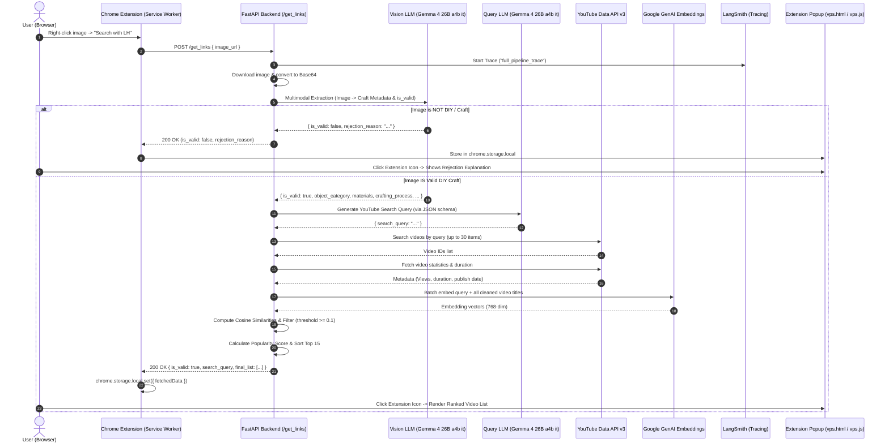

# Link Hunter (LH) — Comprehensive Architecture & Pipeline Context

> **Document Purpose**: This file serves as an exhaustive, self-contained knowledge base for AI models and engineers to understand the architecture, data flow, tech stack, algorithms, and deployment mechanics of the **Link Hunter** system.

---

## 1. Executive Summary

**Link Hunter** is an AI-powered visual search system delivered as a Google Chrome Extension backed by a containerized FastAPI service. 

When a user browses craft, DIY, or hobby websites (such as Pinterest, Etsy, or blogs) and right-clicks on an image of a handmade creation, Link Hunter:
1. Validates whether the image depicts a genuine DIY/handmade craft.
2. Extracts structured visual metadata (craft category, materials, technique).
3. Synthesizes a natural, high-intent YouTube search query.
4. Queries the YouTube Data API v3 for tutorial candidates.
5. Performs batch vector semantic filtering using Google Gemini embeddings to eliminate irrelevant videos.
6. Ranks candidate tutorials by combining semantic relevance and a time-decay popularity score.
7. Displays the ranked video tutorials in the Chrome extension popup interface.

---

## 2. High-Level Architecture



---

## 3. Technology Stack

### 3.1. Frontend (Client-side)
* **Platform**: Google Chrome Extension (Manifest V3)
* **Core Components**:
  * `service-worker.js`: Background event-driven script for context menu handling and asynchronous backend HTTP communication.
  * `vps.html` / `vps.css` / `vps.js`: Popup interface rendering tutorial lists, view counts, and fallback/rejection states.
  * `chrome.storage.local`: Inter-component state transfer between the background service worker and the popup UI.
* **Dependencies**: Native Web APIs (`fetch`, `DOM`, `chrome.*` Extension APIs). Zero external JS frameworks.

### 3.2. Backend (Server-side)
* **Runtime**: Python 3.12 (CPython)
* **Framework**: FastAPI (ASGI) + Uvicorn
* **CORS**: Configured with `CORSMiddleware` (permits `*` origins to support Chrome extension requests).
* **LLM & Embeddings Orchestration**:
  * `langchain-google-genai`: Integration for Google Generative AI models.
  * Vision & Query LLM: `gemma-4-26b-a4b-it` (optimized for lower latency and structured JSON output).
  * Text Embedder: `gemini-embedding-001` (output dimension: 768).
* **Data Validation**: Pydantic v2 schemas (`BaseModel`, `Field`).
* **Math & Vector Operations**: NumPy (`np.linalg.norm`, `np.dot` for cosine similarity).
* **External APIs**: YouTube Data API v3 (`search` and `videos` endpoints).
* **Observability**: LangSmith (`@traceable` decorator for execution spans and latency monitoring).

### 3.3. Infrastructure & DevOps
* **Containerization**: Docker (`python:3.12-slim` multi-stage/cached base image).
* **Target Architecture**: `linux/amd64` (built via `--platform linux/amd64` for cloud compatibility).
* **Registry**: Docker Hub (`godsane/link_hunter:latest`).
* **Hosting**: Render (Web Service deploying Docker image).

---

## 4. End-to-End Pipeline Deep Dive

### Step 1: Client Capture & Request Dispatch
* User triggers the context menu item `Search with LH` on an image (`contexts: ["image"]`).
* `service-worker.js` extracts `info.srcUrl` and posts a payload to `/get_links`:
  ```json
  { "image_url": "https://..." }
  ```

### Step 2: Image Ingestion & Base64 Encoding
* Backend downloads the image using a simulated desktop browser `User-Agent`.
* Validates `status_code == 200` and `Content-Type: image/*`.
* Encodes binary bytes into a Base64 Data URI: `data:{content_type};base64,{encoded}`.

### Step 3: Stage 1 — Visual Data Extraction & Craft Validation
* **Model**: `gemma-4-26b-a4b-it` (temperature `0.0`).
* **Structured Output Schema (`op_schema1`)**:
  ```python
  class op_schema1(BaseModel):
      is_valid: bool              # True if DIY/craft, False if mass-produced/nature/car/screenshot
      rejection_reason: Optional[str] # 1-line reason if is_valid is False
      object_category: Optional[str]  # e.g., "keychain", "plushie", "greeting card"
      detailed_description: Optional[str] # 1-line appearance description
      materials: Optional[str]        # Visible materials, e.g., "wool yarn, metal ring"
      crafting_process: Optional[str] # Specific technique, e.g., "amigurumi crochet"
  ```
* **Robust Parser & Fallback Mechanism**:
  If native LangChain structured output parsing fails (due to model conversational output or formatting inconsistencies), a custom regex fallback parser searches for ````json { ... } ```` markdown blocks or bare `{ ... }` blocks and converts the payload into the Pydantic model.
* **Early Rejection**: If `is_valid == False`, the pipeline halts early and returns the rejection reason to the extension.

### Step 4: Stage 2 — YouTube Search Query Optimization
* **Model**: `gemma-4-26b-a4b-it` (temperature `0.0`, `response_mime_type="application/json"`).
* **Structured Output Schema (`op_schema2`)**:
  ```python
  class op_schema2(BaseModel):
      search_query: str
  ```
* **Input Injection**: Formats metadata extracted in Stage 1 using safe dictionary access (`.get("field") or ""`) to prevent runtime exceptions.
* **Query Construction Directives**:
  * Prioritizes the exact object/technique.
  * Formulates human-like search strings with tutorial intent (e.g., *"how to crochet a tortoise keychain tutorial"*).

### Step 5: Stage 3 — YouTube Video Retrieval
* **API Calls**:
  1. `search`: Queries `https://www.googleapis.com/youtube/v3/search` for top 30 video IDs (`type=video`).
  2. `videos`: Batches all video IDs into a single request to `https://www.googleapis.com/youtube/v3/videos` requesting `snippet,statistics,contentDetails`.
* **Output Normalization**:
  * Extracts view count (`viewCount`).
  * Parses published time and computes relative age in years (`format_published`).
  * Converts ISO 8601 duration (`PT15M30S`) to readable strings (`format_duration` $\rightarrow$ `"15m, 30s"`).

### Step 6: Stage 4 — Batch Semantic Filtering & Ranking
* **Title Sanitization (`clean_title_for_embedding`)**:
  * Splits CamelCase/PascalCase compound words (e.g., `CrochetTutorial` $\rightarrow$ `Crochet Tutorial`).
  * Converts hashtags and underscores into plain whitespace.
  * Strips emojis, special punctuation, and normalizes spacing.
* **Batch Vector Embeddings**:
  * Model: `gemini-embedding-001` (768 dimensions).
  * `embedder.embed_query(search_query)`: Generates search query vector.
  * `embedder.embed_documents(cleaned_titles)`: **Batches all candidate titles in a single network call** (drastically reducing latency from ~20s down to <0.5s).
* **Cosine Similarity**:
  $$\text{Cosine}(v_1, v_2) = \frac{v_1 \cdot v_2}{\|v_1\| \|v_2\|}$$
  Filters out videos with similarity below the threshold (`cosine_score >= 0.1`).
* **Popularity & Freshness Scoring (`calculate_score`)**:
  $$\text{Score} = \frac{\text{Views in Millions}}{1.2^{\text{Years Old}}}$$
  Balances raw popularity against content age to prevent decades-old videos from dominating recent high-quality crafts.
* **Top-K Selection**: Slices the top 15 videos sorted by cosine score.

### Step 7: UI Rendering
* Returns the structured response to Chrome extension:
  ```json
  {
    "is_valid": true,
    "rejection_reason": null,
    "search_query": "how to crochet a tortoise keychain tutorial",
    "total_results": 15,
    "final_list": [
      {
        "title": "Easy Crochet Turtle Keychain Tutorial",
        "link": "https://www.youtube.com/watch?v=...",
        "duration": "12m, 45s",
        "views": "1.2M",
        "publishedTime": 1,
        "product_name": "how to crochet a tortoise keychain tutorial",
        "score": 1.0,
        "cosine_score": 0.842
      }
    ]
  }
  ```
* `vps.js` reads the response from `chrome.storage.local` and injects interactive links and views into the popup DOM.

---

## 5. Performance Optimizations Implemented

| Optimization | Before | After | Impact |
| :--- | :--- | :--- | :--- |
| **Model Weight Optimization** | `gemma-4-31b-it` | `gemma-4-26b-a4b-it` | Reduced LLM inference latency from **~80s $\rightarrow$ ~30s**. |
| **Vector Embedding Strategy** | Sequential loop (`embed_query`) $\times$ 20 calls | Batch call (`embed_documents`) $\times$ 1 call | Reduced semantic filtering stage from **~20s $\rightarrow$ < 0.5s**. |
| **Grammar Constrained Output** | Raw Markdown / Regex parsing | Native `response_mime_type="application/json"` | Eliminated markdown wrapping, reasoning tokens, and retry loops. |
| **Prompt Engineering** | Verbose prompt with invalid JSON template | Streamlined instructions with safe `.get()` fallbacks | Reduced token generation overhead and eliminated `KeyError` crashes. |
| **Decorator Execution Order** | `@traceable` above `@app.post` | `@app.post` above `@traceable` | Fixed FastAPI router trace-interception in LangSmith. |
| **Docker Caching** | `COPY . /app` before `pip install` | `COPY requirements.txt` then `pip install`, then `COPY . .` | Cut container rebuild time from **2–3 mins $\rightarrow$ ~1 sec**. |

---

## 6. Project Directory Map

```text
LH/
├── full_context.md                     # This file (Complete architecture & context)
├── .gitignore                          # Git exclusions (.DS_Store, .vscode, .env, __pycache__)
├── .lh_venv/                           # Active Python 3.12 virtual environment
│
├── ex_fast_bend/                       # Production FastAPI Backend
│   ├── fast_server.py                  # Production server & pipeline definition
│   ├── dockerfile                      # Docker container specification (python:3.12-slim)
│   ├── .dockerignore                   # Build context exclusions (.env, __pycache__)
│   ├── requirements.txt                # Production backend dependencies
│   ├── req.txt                         # Dependency variants
│   ├── .env                            # Secret keys (Google GenAI, YouTube, LangSmith)
│   ├── .python-version                 # Environment version specification (3.11/3.12)
│   ├── pl_test.py                      # Standalone CLI end-to-end pipeline tester
│   ├── LLM_test.py                     # Isolated Vision LLM testing script
│   ├── ab_testing.py                   # A/B prompt evaluation against benchmark dataset
│   ├── evaluate_responses.py           # Evaluation of responses & similarity scores
│   ├── eval_dataset_lh.csv             # Benchmark craft image evaluation dataset
│   ├── unit_test.py                    # Minimal sanity test for Google GenAI LLM
│   ├── fbc.txt / fbc2.txt              # Fallback parser reference notes
│   └── __pycache__/                    # Compiled Python bytecodes (ignored)
│
├── ex_frontend/                        # Chrome Extension (Manifest V3)
│   ├── manifest.json                   # Extension configuration & permissions
│   ├── service-worker.js               # Background service worker (Context Menu & API Fetch)
│   ├── vps.html                        # Popup UI markup
│   ├── vps.js                          # Popup UI presentation logic
│   ├── vps.css                         # UI styling & layouts
│   └── icons/                          # Application icons (16, 32, 48, 128 px)
│
└── ex_backend/                         # Legacy/Alternative Backend (Torch / Transformers)
    └── .venv/                          # Legacy Python 3.9 virtual environment
```

---

## 7. API Specification

### `POST /get_links`
* **Content-Type**: `application/json`
* **Request Body**:
  ```json
  {
    "image_url": "https://i.pinimg.com/736x/...jpg"
  }
  ```
* **Success Response (`200 OK`) — Valid DIY Craft**:
  ```json
  {
    "is_valid": true,
    "rejection_reason": null,
    "search_query": "string",
    "total_results": 15,
    "final_list": [
      {
        "title": "string",
        "link": "https://www.youtube.com/watch?v=...",
        "duration": "14m, 20s",
        "views": "1.5M",
        "publishedTime": 2,
        "product_name": "string",
        "score": 1.042,
        "cosine_score": 0.8124
      }
    ]
  }
  ```
* **Success Response (`200 OK`) — Non-Craft Rejection**:
  ```json
  {
    "is_valid": false,
    "rejection_reason": "The image displays a commercially manufactured car, not a DIY craft.",
    "search_query": null,
    "total_results": null,
    "final_list": null
  }
  ```
* **Error Response (`400 Bad Request`)**: Missing or empty `image_url`.
* **Error Response (`500 Internal Server Error`)**: Failures in image downloading, model retries exhausted, or upstream YouTube API errors.

### `GET /health`
* **Response**: `{"message": "All fine dude"}`

---

## 8. Required Environment Variables

To run the backend locally or in a container, the following variables must be present in `.env` (or passed to the container runtime via `--env-file`):

```bash
# Google Gemini API (Required for Vision LLM, Query LLM, & Embeddings)
GEMINI_API_KEY="your-gemini-api-key"
GOOGLE_API_KEY="your-gemini-api-key"

# YouTube Data API v3 (Required for video search and statistics)
YOUTUBE_API_KEY="your-youtube-data-api-key"

# LangSmith Observability (Optional but recommended for tracing)
LANGCHAIN_TRACING_V2="true"
LANGCHAIN_API_KEY="your-langsmith-api-key"
LANGCHAIN_PROJECT="link-hunter"
```

---

## 9. Containerization & Deployment Reference

### 9.1. Local Container Build & Run
```bash
cd ex_fast_bend

# Build AMD64 image (required for cloud environments like Render)
docker build --platform linux/amd64 -t godsane/link_hunter:latest .

# Run locally with .env injected
docker run -p 8000:8000 --env-file .env godsane/link_hunter:latest
```

### 9.2. Push to Docker Hub
```bash
docker push godsane/link_hunter:latest
```

### 9.3. Render Cloud Deployment
* **Service Type**: Web Service
* **Deployment Mode**: Existing Image from Registry
* **Image URL**: `docker.io/godsane/link_hunter:latest` (or `godsane/link_hunter:latest`)
* **Environment Variables**: Add `GOOGLE_API_KEY`, `YOUTUBE_API_KEY`, `LANGCHAIN_API_KEY`, `LANGCHAIN_PROJECT`, `LANGCHAIN_TRACING_V2`.

